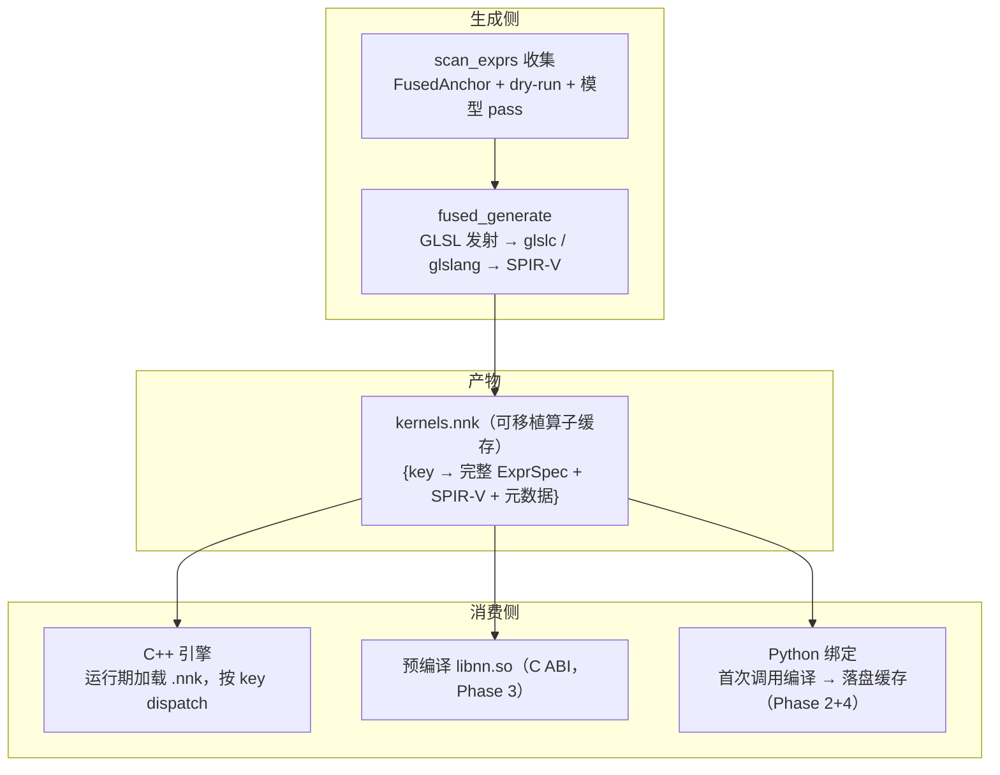

# ComputeEngine 解耦与可移植算子缓存（kernels.nnk）

> **读者**：项目开发者（改这个库的人）。本分册定位见 [`README.md`](README.md)；历史归档在 [`../history/history.md`](../history/history.md)。
> **一句话结论**：把 AOT 融合注册表从构建期内嵌头（`fused_registry.hpp`）解耦为**可移植二进制算子缓存 `kernels.nnk`**——C++ 构建期生成、引擎运行期加载（闭合世界硬报错改在**加载/派发期**强化），C++ 与 Python 共用同一份数据契约，为后续 Python 绑定铺路。本轮只做 **Phase 1**（`.nnk` 契约 + 独立生成器 + 引擎运行期加载）；SPIR-V 运行期编译走打包 glslang/shaderc（B2），是 Phase 2。
> **状态**：现行（Phase 1 实施中；Phase 2–4 为 ⏳ 计划，见 §2）。

## 0. 背景与目标

### 0.1 现状：融合注册表被构建系统绑死

AOT 融合（`docs/internal/02-operator-fusion.md`）的"闭合世界"闭环跨越两层，是**构建期耦合**本体：

1. **收集**：`tools/scan_exprs.cpp`（`#include` 整个库：`compute_layer.hpp`、`domain_{cnn,gpt,mnist,rla}.hpp`、`rl_*`）经 `FusedAnchor<Expr>` 自登记 + dry-run（逐层 forward/backward）+ 模型 pass 枚举全部融合结构，存入 `ExprRegistry`（`expr_registry.hpp`，按 `expr_spec_key` 去重）。
2. **发射**：`tools/fused_generate.hpp` 对每条结构出 GLSL → glslc → SPIR-V，**内联写进 `fused_registry.hpp`**（C++ 头，`FusedShader{ key, ExprSpec, spirv, spirv_words, reduce_axis, has_matmul, view_param_count, rparam_count, vec_width, prec_sig }` 表）。
3. **消费**：`compute_gpu_engine.hpp:50` / `backend/compute_vk_backend.hpp:424` 在编译期 `#include fused_registry.hpp`，运行期按 key 精确 dispatch，未命中硬报错（闭合世界）。

后果：**生成头被引擎 `#include`** → 引擎（和每个 GPU 消费 TU）编译期耦合一份由"全库 Layer 表达式"派生的生成物；这份产物 Python 无法加载。

### 0.2 两个动机收敛成一个动作

- **解耦**：引擎运行时不依赖 Layer 表达式派生的生成物；跨 Layer 边界只流一份**数据文件**，不再是代码。
- **Python 远景**：Python 无法编译 C++，需要一份可加载的预编译产物 + 一个运行期可调用的算子生成组件。可移植算子缓存就是那份产物。

两者收敛成同一件事：**把融合注册表降级为可移植数据文件 `.nnk`**。

### 0.3 前提澄清（为什么拆仓不是答案）

编译慢的根因是每 TU 自己的 `-O3` codegen（PCH 后 `-ftime-trace`：后端 29.1s vs 前端 4.0s，见 `AGENTS.md` §2），header-only 的引擎搬到另一个仓仍是"每消费 TU 编一遍"，零收益。真正能提速的是**引入 link 阶段**（引擎翻成预编译库），而那也是 Python 能加载 `.so` 的前提——那是 Phase 3，不是本轮。本轮只解耦融合注册表的**数据边界**，不动编译模型。

## 1. 已锁定的决策

| # | 决策 | 取值 | 理由 |
|---|------|------|------|
| D1 | 本轮范围 | **仅 Phase 1** | 边界清楚、可回归验证；Phase 2–4 各自独立可验证 |
| D2 | C++ 消费路径 | **A2：只产 `.nnk`，引擎完全运行期加载** | 真正解耦；闭合世界硬报错改在加载/派发期强化（见 §5.4） |
| D3 | SPIR-V 运行期路径 | **B2：复用现有 GLSL 发射 + 打包 glslang/shaderc** | 手写 SPIR-V 发射器很难超过 glslc 自带优化；glslc 与 glslang 同源，C++/Python 发射器可保持一致 |
| D4 | `.nnk` 内容 | 只含**融合算子**（`FusedShader` 表）；**手写原语 shader 留在嵌入** | 原语（44 份 `*_spv.hpp`，`NN_SPV_GETTER_LIST` X 宏）自包含、不依赖 Layer，无解耦必要，收窄 `.nnk` 边界与 blast radius |
| D5 | `.nnk` 序列化 | **必须序列化完整 `ExprSpec`**（不只 key+SPIR-V） | 运行期 IR-C 图融合 `execute_fused_graph` 直接读 `k.spec.fold/extras/views`（`compute_gpu_engine.hpp:1866,1956,2384` 等），key 不足以支撑 |

## 2. 目标架构（四阶段）



- **Phase 1（本轮）**：`.nnk` 文件格式 + `ExprSpec` 序列化器 + 生成器发射端改造（收集不变、发射从 header 改 binary）+ 引擎运行期加载（A2，移除 `#include fused_registry.hpp`）。
- **Phase 2（⏳）**：运行期 SPIR-V 编译——打包 glslang/shaderc，Python 首次调用对未命中结构现编 → 落盘缓存（D3/B2）。C++ 侧发射器与 Python 侧共用同一 GLSL 前端，保证逐位一致。
- **Phase 3（⏳）**：引入 link 阶段——引擎 + Layer 翻成预编译 `.so` + 稳定 C ABI（vtable 边界），同时解决"正经 C++ 项目提速"与"Python 可加载"。这是独立的编译模型大改，本轮不做。
- **Phase 4（⏳）**：Python 绑定（ctypes/cffi/pybind 加载 Phase 3 的 `.so` + 走 Phase 2 的算子缓存）。

> 分阶段落地与执行顺序见 §7；本设计稿是 `docs/internal/27-execution-plan.md` 之外的专项方案（同 `31`/`26`/`04` 的先例），不在 18 号重复立项。

## 3. `.nnk` 文件格式（Phase 1 核心契约）

### 3.1 布局（对齐本仓模型文件惯例：`magic|version|…|sha256|trailer`）

```
magic     8B   "NNKFUSED"
version   u32  1
flags     u32  位 0 = 仅 GPU 融合算子（本版恒 1）
count     u32  条目数
[条目 × count]
  key       u32 len + bytes        （expr_spec_key，含 #x/#s/#a/#b/#f/#ks/#kr 变体后缀）
  spec      u32 len + bytes        完整 ExprSpec 序列化（D5，见 §3.2）
  spirv     u32 words + u32[]      SPIR-V 二进制
  meta      u32 reduce_axis        -1 逐元素 / 0 行归约 / 1 列归约
            u32 has_matmul        0/1
            u32 view_param_count
            u32 rparam_count
            u32 vec_width
            u32 prec_sig           变体签名（V0=0；V1=EXPR_PREC_SIG_DISPATCH；V2 位图）
sha256   32B   整文件校验和（不含 sha256 与 trailer）
trailer  5B   "NNEND"
```

- 每条目的 `ExprSpec` 是**canonical 形态**（与 `ExprRegistry::add` 一致，`canonicalize_expr_spec` 后 `expr_spec_key`），保证收集端与运行期两端 key 一致。
- 校验和走 `nn::sha256`（`core_sha256.hpp`，模型文件同源），截断/损坏明确报错，对齐 `verify_model_integrity` 的先行校验语义。
- 多平台端序：全文件 **little-endian**（与 SPIR-V 一致），读取端 `read_pod_span`（`core_file.hpp`，glslc 产物读取已用它）。

### 3.2 `ExprSpec` 序列化

`ExprSpec`（`expr_spec.hpp`）是拍平 IR，字段全 POD + `std::vector`：`operands`/`views`/`instrs`（`std::vector<ExprOperand/ExprView/ExprInstr>`）、`matmul`（`MatmulSpec`）、`vecacc`（`VecAccSpec`）、`fold`（`FoldSpec`）、`num_regs`/`num_rparams`/`n`/`axis` 等标量。序列化器按版本化的逐字段写出，长度前缀 + 版本号；**round-trip 必须逐位一致**（回归测试锁，见 §7）。

> 实现注：`ExprInstr` 含 `Extras`（P2 写穿多输出 ≤4 成员），`FoldSpec` 含 `tri_skip`/`vec_state_len` 等——序列化需覆盖全字段，避免漏字段导致运行期图融合读到未初始化值。

### 3.3 与手写原语 shader 的关系

`.nnk` **不含** 44 份 `*_spv.hpp`（D4）。原语继续经 `NN_SPV_GETTER_LIST` X 宏编译期内嵌（自包含、无 Layer 依赖、不随模型结构变化），本轮不动。

## 4. 独立生成器改造（Phase 1）

`tools/scan_exprs.cpp` 的**收集逻辑不动**（FusedAnchor + dry-run + 模型 pass 是结构的主要来源）。改动集中在发射端 `tools/fused_generate.hpp`：

- 新增二进制序列化路径：`generate_kernel_cache(out_dir)` 把 `ExprRegistry`（specs + 各变体 SPIR-V）写成 `kernels.nnk`，替代/并列于现有 `generate_fused_registry` 写 header。
- D2（只产 `.nnk`）→ **删除 `fused_registry.hpp` 发射**，只留 `.nnk`。SPIR-V 生成过程（GLSL → glslc）不变，只是落盘格式从"C++ 数组"改为"二进制条目"。
- 产物落 `<build>/generated/kernels.nnk`，CMake 以自定义命令生成 + `restat`（内容不变不重编，对齐现有 `fused_registry.hpp` 的处理）。

> 发射端"内容稳定写入"（内容不变则不动 mtime）是现有 `restat` 前提，二进制写入同样保持，避免下游全量重编。

## 5. 引擎运行期加载（Phase 1，D2/A2）

### 5.1 替换点

- `compute_gpu_engine.hpp:50` 与 `backend/compute_vk_backend.hpp:424` 的 `#include fused_registry.hpp` **删除**。
- 引入 `nn::fused::KernelCache`（规划中的新加载器类型）：加载 `.nnk`，持有 `std::vector<FusedShader>`（或哈希表 `unordered_map<string, size_t>`），提供 `hit(key)` / 遍历接口——签名对齐现有 `FusedShader` 表消费（`hit(nn::expr_prec_sig_key(...))` 调用点见 `compute_gpu_engine.hpp:1372,2325` 等）。
- `compute_vk_backend.hpp` 通过注入的 `KernelCache&`（或 `GpuBackend` 成员）取 SPIR-V，取代对 `kSpirv_xxx[]` 编译期数组的直接引用。

### 5.2 缓存定位

运行期加载需知道 `.nnk` 路径。采用编译期注入宏 + 环境变量覆盖（对齐 `NN_VULKAN_DEVICE` 等"读一次 + 缓存"的行为开关先例）：

- 构建期注入 `NN_FUSED_CACHE_PATH=<绝对路径>`（CMake 写进编译定义），默认指向 `<build>/generated/kernels.nnk`。
- 环境变量 `NN_FUSED_CACHE_PATH` 覆盖（测试/部署可换路径）。
- 未找到/损坏 → **明确报错**（`Result`，不静默降级），提示重跑构建。

### 5.3 闭合世界语义迁移（关键取舍）

原"编译期内嵌 = 常量数组，恒存在"；改运行期文件加载后，闭合世界硬报错从**编译期**迁到**运行期两处**：

1. **加载期**：`.nnk` 缺失/校验失败 → 硬错误（`Result`）。C++ 构建期生成的 `.nnk` 由 `scan_exprs` 保证穷尽枚举，故正常构建下加载期即可确认"闭合世界完整"。
2. **派发期**：运行期折叠出的 key 未命中已加载缓存 → 硬报错（保留现有 `eval_expr_impl` 未命中报错语义，`compute_gpu_engine.hpp:1511`）。

> 这是"保证穷尽（C++ 构建期）"与"懒 + 缓存（Python 运行期）"的分界：C++ 侧两种硬保证都保留；Python 侧（Phase 2/4）允许对未命中结构现编并追加缓存（首用延迟），语义不同、是合理的分侧取舍。

### 5.4 热路径影响

- 加载是**一次性**（init 期/首次 GPU 派发），不进热循环。
- 派发期 `hit(key)` 从"编译期数组线性扫/表查"改为"已加载哈希表查"——key 已是字符串哈希，映射为 `unordered_map<string, uint32_t>` 命中，与原数组索引同级。
- 目标：**GPU 融合路径与现有逐位一致**，端到端 step 时间无回归（回归锁见 §7）。

## 6. 双消费路径（C++ / Python）

| 阶段 | C++ 构建 | Python 运行 |
|------|----------|-------------|
| Phase 1（本轮） | 生成器产 `.nnk`；引擎运行期加载 | （无绑定）但 `.nnk` 即 Python 将加载的产物 |
| Phase 2（⏳） | 不变 | 首次调用：glslang 编未命中结构 → 落盘缓存；下次命中 |
| Phase 3（⏳） | 引擎 + Layer 翻 `.so` + C ABI | 加载预编译 `.so`（ctypes/cffi/pybind） |
| Phase 4（⏳） | 不变 | 绑定 + 走 Phase 2 缓存 |

- Phase 1 交付的 `.nnk` 格式就是 Python 后续加载的**数据契约**；Phase 2 的 glslang 与 Phase 1 的 glslc 同源（D3），保证 C++/Python 发射的 SPIR-V 逐位一致。

## 7. Phase 1 落地与验收

### 7.1 改动清单

1. `KernelCache` 加载器 + `.nnk` 解析（含校验和）。
2. `tools/fused_generate.hpp`：新增 `generate_kernel_cache` 二进制发射 + `ExprSpec` 序列化器（序列化逻辑放生成器或独立头）。
3. `compute_gpu_engine.hpp` / `backend/compute_vk_backend.hpp`：移除 `#include fused_registry.hpp`，注入 `KernelCache`。
4. `CMakeLists.txt`：生成规则从 `fused_registry.hpp` 改产 `kernels.nnk` + 注入 `NN_FUSED_CACHE_PATH`；删除 `NN_FUSED_REGISTRY_EMBEDDED` 相关。
5. 回归测试：`ExprSpec` round-trip 逐位锁；GPU 融合路径（`fused_gpu_test` / `expr_fuse_test`）经新加载路径跑通。

### 7.2 验收口径

- [x] `ExprSpec` 序列化 round-trip 与内存对象逐位一致（`src/kernel_cache_test.cpp`，已过：逐元素 / matmul / fold v1 / fold v2 双域 / extras / consts+rparams / 运行时参数视图，全部 `expr_spec_equal` 逐位一致；负例 magic/截断/校验和均报错）。
- [ ] GPU 融合测试（`fused_gpu_test`/`expr_fuse_test`）在新加载路径下通过，`--hash` 对拍逐位不变（如有 kernel 逐位锚）。
- [ ] `.nnk` 缺失/损坏 → 明确 `Result` 错误（加载器负例已锁，见 `kernel_cache_test`）。
- [ ] `scan_exprs` 发射端改产 `.nnk` 后，GPU 构建与运行全链路闭合。
- [ ] 文档同步：`AGENTS.md` §7（引用 `fused_registry.hpp`/`NN_SPV_GETTER_LIST` 处）、`docs/internal/README.md` 索引、总索引；`python scripts/doc_audit.py` 全绿。
- [ ] 手写原语 shader（44 份 `*_spv.hpp`）不动、仍嵌入（D4）。

> **Phase 1 实施进度**：⏳ 待做 = 生成器发射端改产 `.nnk`（`fused_generate.hpp` 的 `generate_kernel_cache`）、引擎运行期加载（`KernelCache` 注入 + 移除 `#include fused_registry.hpp`）、CMake 生成规则改产 `.nnk` + 注入 `NN_FUSED_CACHE_PATH`、GPU 融合回归。✅ 已做 = `.nnk` 格式 + `ExprSpec` 序列化器 + `KernelCache` 加载器 + round-trip 回归测试（`src/kernel_cache_test.cpp`，已登记 ctest）。

### 7.3 不做（非本轮）

- Phase 2 的 glslang 运行期编译、Phase 3 的 link 阶段 / `.so` / C ABI、Phase 4 的 Python 绑定——均 ⏳ 计划，不在本轮实现。
- 原语 shader 不进 `.nnk`（D4）。
- 不拆仓（§0.3）。

## 8. 风险与取舍

| 风险 | 影响 | 对策 |
|------|------|------|
| 运行期加载引入文件 I/O / 路径定位 | 启动/首用延迟 | 一次性加载不进热路径；构建期注入绝对路径 |
| `ExprSpec` 序列化漏字段 | 图融合读到未初始化值（静默错值） | round-trip 逐位回归锁；序列化器全字段覆盖 |
| 闭合世界从编译期迁运行期 | 部署缺 `.nnk` 时错误变运行期 | 加载期先行校验 + 明确报错（`Result`），不静默降级 |
| C++ 热路径由数组查改哈希表查 | 潜在微小开销 | 一次性构建 `unordered_map`；目标无 step 时间回归 |
| 只产 `.nnk`（D2）双端同步消失 | C++/Python 用同一产物 | 单一真源，无 `fused_registry.hpp` 第二份产物要同步 |

## 9. 关联文档

- 融合全篇：`docs/internal/02-operator-fusion.md`（IR / AOT 收集 / 闭合世界）
- IR 优化链：`docs/internal/03-ir-optimization.md`（IR-C 图融合为现行能力）
- 引擎接口现状：`docs/internal/12-compute-engine-inventory.md`
- 嵌入消费方指南：`docs/usage/05-consume-as-library.md`（`nn_enable_gpu_fusion`）
- 文件格式先例（校验和/trailer 惯例）：`docs/internal/23-library-design-cleanup-and-model-file-roles.md`
- 历史归档：`docs/history/history.md`
