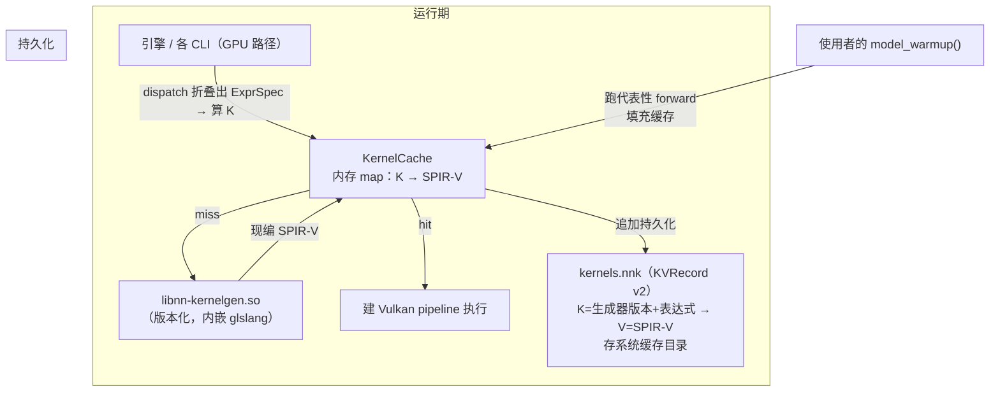

# ComputeEngine 解耦与可移植算子缓存（kernels.nnk）

> **读者**：项目开发者（改这个库的人）。本分册定位见 [`README.md`](README.md)；历史归档在 [`../history/history.md`](../history/history.md)。
> **一句话结论**：`.nnk` 是**运行期 JIT 算子缓存**（torch.compile 式），不是部署代码模块——`K=生成器版本+expr_spec_key → V=SPIR-V`，用 KVRecord v2 承载，存系统统一缓存目录；引擎运行期查缓存、miss 则经版本化的生成器 `.so`（内嵌 glslang）现编 SPIR-V 并追加持久化；使用者靠 `model_warmup()` 预热，**无需注册任何表达式、无构建期闭合世界**。这同时把生成器抽成可 install 的 `.so`（干净 bin/ + lib/ 产物）。
> **状态**：现行（Phase 1 重构中：容器改为 KVRecord v2）。

## 0. 定位与动机

### 0.1 库的定位（影响全部后续决策）

**一个 engine-first 的便携、可部署的神经网络计算核心 + 轻量训练/推理表面 + Python 访问层**，锚定"推理/边缘部署（主）+ 可复现研究（辅）"：

- **便携**：Vulkan compute 跨厂商（不锁 NVIDIA），SPIR-V 设备无关。
- **确定性回归锁**：CPU/GPU 对拍逐位一致（`--hash`、回归锚）。
- **从零清晰**：BPE 分词器、KVRecord、RLA/RAPT、三值 BitNet 全手写。

**不是**"Vulkan 版 torch"——torch 的护城河是生态（自动微分图/分布式/社区模型），单人库追不上也不该追。守"深、窄、便携、确定"的 niche。

### 0.2 定位对融合算子的三个裁定

1. **AOT 从"身份/契约"降级为"优化 + 内部纪律"**。闭合世界（构建期穷举 + 运行期硬报错）只对作者自己的小世界成立，对使用者是**敌意的**（新表达式没被枚举就硬报错）。库要给人用，就不能强迫使用者继承这套。大框架（TensorRT/ONNX Runtime/TVM）对已知结构 AOT、对未知走 JIT/fallback——**AOT 能规模化，硬报错的闭合世界不能**。
2. **`.nnk` = 缓存，不是 `.so`/`.dll` 部署模块**。它是可再生的 JIT 算子缓存（torch.compile 的 compiled artifact），不是随模型分发的交付物。
3. **不降级未命中，未命中走 JIT**。miss 现编 SPIR-V、追加进缓存，永不静默回退 CPU/边界 cast——"每种用到的结构最终都有融合 kernel，只是首次命中有一次编译延迟"。

### 0.3 两个前置事实（决定架构形状）

- **header-only 让 LGPL 失效**：LGPL 的核心承诺是"消费方能替换/重链库的 `.so`"，header-only 把库代码内联进消费方二进制，没有可替换的库二进制 → LGPL 形同 GPL。解药 = **link 阶段（预编译 `.so` + C ABI）**，兼解编译慢。
- **编译慢的根因是 per-TU codegen，不是头解析**（PCH 后 `-ftime-trace`：后端 29.1s vs 前端 4.0s）。真正提速靠**引入 link 阶段**，不是拆仓。

## 1. 已锁定决策

| # | 决策 | 取值 | 理由 |
|---|------|------|------|
| D1 | `.nnk` 定位 | **缓存**（JIT），非 `.so`/部署模块 | torch.compile 式；可再生可丢弃 |
| D2 | `.nnk` 记录 | **K = 生成器版本号 + `expr_spec_key`；V = 纯 SPIR-V** | 版本进 key → 引擎升级自动隔离旧 SPIR-V，永不读错；V 只存 SPIR-V（运行期有 ExprSpec，meta 现算） |
| D3 | `.nnk` 容器 | **KVRecord v2** | 自描述 + 运行时读写 + 可增长（缓存语义） |
| D4 | 未命中 | **JIT 现编**（不降级） | GlslEmitter → glslang → SPIR-V → 追加持久化 |
| D5 | glslang 载体 | **生成器 `.so`（libnn-kernelgen.so）**，版本化单份，懒加载 | 链进每个 exe = 体积爆炸；系统 glslc = 版本不匹配/可能没有。一个版本化 `.so` 全部解掉 |
| D6 | 表达式来源 | **warmup 驱动**（`model_warmup()`），无注册、无构建期闭合世界 | 使用者不注册任何表达式，跑预热即填充缓存，同 torch.compile |
| D7 | 缓存位置 | **系统统一缓存目录** + `NN_KERNEL_CACHE_DIR`/`NN_KERNEL_CACHE_PATH` 覆盖 | 可再生归 OS 缓存语义；内容寻址 key → 跨应用共享 |
| D8 | 产物 | **install 布局**：`bin/`（cli）+ `lib/`（.so），无散落 `.o/.obj` | 干净、可安装、可打包；LGPL 可用 |

## 2. 目标架构



- **KernelCache**（运行期内存缓存）：`unordered_map<string, vector<uint32_t>>`，key = `"v<生成器版本>." + expr_prec_sig_key(expr_spec_key, 所需签名)`。dispatch 命中 O(1)；miss → 调生成器 `.so`。
- **生成器 `.so`（libnn-kernelgen.so）**：C ABI `ExprSpec(序列化) → SPIR-V`；内嵌 glslang + GlslEmitter；版本 = K 的版本组件，单份、懒加载。
- **`.nnk` 文件**：KVRecord v2，每条记录 K → SPIR-V 字节（string 字段）；含 `nnk_format_version` + `generator_version` 元数据。

## 3. `.nnk` 记录与容器（KVRecord v2）

### 3.1 K / V

- **K** = `"v<生成器版本>." + expr_prec_sig_key(expr_spec_key, 所需签名)`，如 `v3.366917b6a3da7f00#x`。
  - 生成器版本用一个专用常量 `kKernelCacheGeneratorVersion`，只在**代码生成语义变化**时 bump（非每次 release）。
  - 版本进 key → 引擎升级后 key 全变，旧条目永不匹配（孤立无害），新 key 触发重编。**即使缓存混着新旧条目也绝不用错**。
- **V** = 纯 SPIR-V 字节（KVRecord string 字段，length-prefixed，任意字节安全）。

> 运行期 dispatch 时**已有折叠好的 ExprSpec**（`expr_spec_key`/`reduce_axis`/`view_param_count`/`rparam_count`/`vec_width`/`prec_sig` 全部现算），故缓存值只需 SPIR-V。**ExprSpec 不存进 `.nnk`**。

### 3.2 ExprSpec 序列化器的角色：生成器 `.so` 的 C ABI 边界

`ExprSpec` 是 C++ 类型，跨 `.so` 边界传不稳定。生成器 `.so` 暴露稳定 C ABI：

```cpp snippet
// libnn-kernelgen.so（extern "C"）
// 输入：序列化 ExprSpec + 所需精度签名 + 生成器版本 → 输出 SPIR-V 字节
nnk_status nnk_generate_spirv(const uint8_t* spec_bytes, size_t spec_len,
                              uint32_t prec_sig, const char* generator_version,
                              uint8_t** out_spirv, size_t* out_len);
```

**ExprSpec 序列化器 = 生成器 `.so` 的跨边界载荷编码**（复用 `kernel_cache.hpp` 里的 `encode/decode_expr_spec`），**不是缓存值**。这是它与旧"缓存存整条 FusedShader"模型的本质区别。

### 3.3 文件布局（对齐 `.nndataset` 的 KVRecord v2 模式）

`.nnk` = 单个 `KeyValueRecord`（v2）的序列化字节：

```
KeyValueRecord v2:
  "nnk_format_version" := u64
  "generator_version"  := Str
  "kernel.<K1>"        := Str(SPIR-V 字节)     # 每条 kernel 一个字段
  "kernel.<K2>"        := Str(SPIR-V 字节)
  ...
```

- **快速命中**：启动时整文件解析一次 → 内存建 `map<K, SPIR-V>`（O(1) dispatch）。文件不是热路径。
- **运行时读写**：JIT miss → 追加字段 → 重序列化整文件（miss 罕见，重写可接受；绝对偏移寻址天然适合重建）。
- **版本失效**：`generator_version` 与 K 里的版本一致；不一致 → 整个缓存视为陈旧，重建。

## 4. 生成器 `.so` 与 install 产物

### 4.1 为什么是 `.so`（D5）

- 不链进每个可执行文件（glslang 几十 MB × N 个二进制 = 体积爆炸）。
- 不依赖系统 glslc（可能没有 / 版本漂移）。
- 单份 + 版本化 = K 的版本组件确定。

### 4.2 组件划分

- `libnn-kernelgen.so`：内嵌 glslang + GlslEmitter；读 `.nnk` 缓存 / JIT 现编 / 追加持久化；版本号 = K 版本组件。**只 GPU 构建引入；CPU-only 消费方不需要**（CPU 走模板求值，无 SPIR-V）。
- 引擎 / 各 CLI：GPU 路径 dlopen/libnn-kernelgen.so；miss 调它取 SPIR-V。
- install 布局：`bin/`（cli）+ `lib/libnn-kernelgen.so`（+ 后续引擎 `.so`），无散落 `.o/.obj`。

### 4.3 CMake 角色演进

从"生成 build + 各目标散落产物"变成"生成 build + **组合成干净安装产物**"：`install(GNUInstallDirs)`、bin/ + lib/、安装/打包规则。这是构建系统重构（Phase 3 link 阶段前置），不是顺手改动。

## 5. warmup 驱动（D6）

- 库/使用者提供 `model_warmup()`（层级/表达式/模型预热）：跑一遍代表性 forward，把用到的表达式现编进缓存。
- **无注册、无构建期闭合世界**：`scan_exprs` 的 `FusedAnchor` 自登记 + dry-run + 模型 pass + `NN_EXPR_SCAN` + glslc 构建步 + `nn_enable_gpu_fusion` 收集器**全部可拆**。
- 首次调用/预热命中编译（延迟），之后所有 app 共享缓存秒命中。
- 严格模式（可选 `NN_STRICT_CLOSED_WORLD`）保留为 opt-in 看门狗，非默认契约。

## 6. 分阶段落地

| 阶段 | 内容 | 状态 |
|------|------|------|
| **Phase 1** | `.nnk` 缓存容器重构为 KVRecord v2（K=版本+表达式 → V=SPIR-V）+ 加载器 + ExprSpec 序列化器（作为 `.so` 边界）+ 测试 | ⏳ 进行中 |
| **Phase 2** | 生成器 `.so`（libnn-kernelgen.so，内嵌 glslang）+ 运行期 JIT miss + `.nnk` 追加持久化 | ⏳ 待做 |
| **Phase 3** | 引擎 link 阶段 + C ABI + install 布局（bin/ + lib/）+ 打包 | ⏳ 待做 |
| **Phase 4** | Python 绑定（加载 `.so` + `.nnk` 缓存） | ⏳ 待做 |

## 7. Phase 1 验收口径

- [x] `ExprSpec` 序列化 round-trip 逐位一致（`kernel_cache_test`，6 类形态，作为生成器 `.so` 边界载荷）。
- [x] `.nnk` 容器 = KVRecord v2，`K=v<生成器版本>.<expr_spec_key>` → `V=SPIR-V` 字节；round-trip + `generator_version` 不符 → 判陈旧（旧 kernel 不命中）+ 可重建。
- [x] KernelCache：加载 → 内存热缓存懒加载 → 命中 O(1)（key_index_）；`insert` 追加 + `serialize` 回环。
- [ ] 系统缓存目录定位 + `NN_KERNEL_CACHE_DIR`/`NN_KERNEL_CACHE_PATH` 覆盖（读一次缓存）。
- [ ] 文档同步 + `python scripts/doc_audit.py` 全绿（当前已绿）。

> **Phase 1 实施进度**：✅ 已做 = KVRecord v2 容器重构（`kernel_cache.hpp`）+ `K` 编码（版本进 key）+ 版本失效 + 懒加载热缓存 + 测试；构建期 `.nnk` 发射已回退（warmup 模型不需要）。⏳ 待做 = 系统缓存目录定位 + 引擎运行期接入（Phase 2 生成器 `.so`）。

## 8. 风险与取舍

| 风险 | 影响 | 对策 |
|------|------|------|
| 运行期 JIT 首用延迟 | 首次/预热有编译延迟 | warmup 显式填充；缓存命中后秒回 |
| KVRecord v2 追加重写整文件 | miss 时写放大 | miss 罕见（warmup 后基本不 miss）；重写简单且绝对偏移天然适配 |
| 生成器 `.so` 版本漂移 | 跨版本混用读到旧 SPIR-V | 版本进 K → 永不匹配旧条目；`generator_version` 判陈旧 |
| 多进程共享缓存并发写 | 写坏文件 | 原子写（temp+rename）+ 进程锁 |
| glslang 构建期依赖（GPU） | 构建变重 | 只 GPU 构建引入；打进单一 `.so` 懒加载 |
| 确定性 AOT 让位 warmup+JIT | 失去闭合世界看门狗 | 严格模式保留为 opt-in；内部纪律仍在 |

## 9. 关联文档

- 融合全篇：`docs/internal/02-operator-fusion.md`
- 文件格式先例（KVRecord v2 / `.nndataset`）：`docs/internal/19-unified-dataset.md` + `docs/development/10-kvrecord-format-spec.md`
- 库级角色/参数形态：`docs/internal/23-library-design-cleanup-and-model-file-roles.md`
- 嵌入消费方指南：`docs/usage/05-consume-as-library.md`
- 历史归档：`docs/history/history.md`
