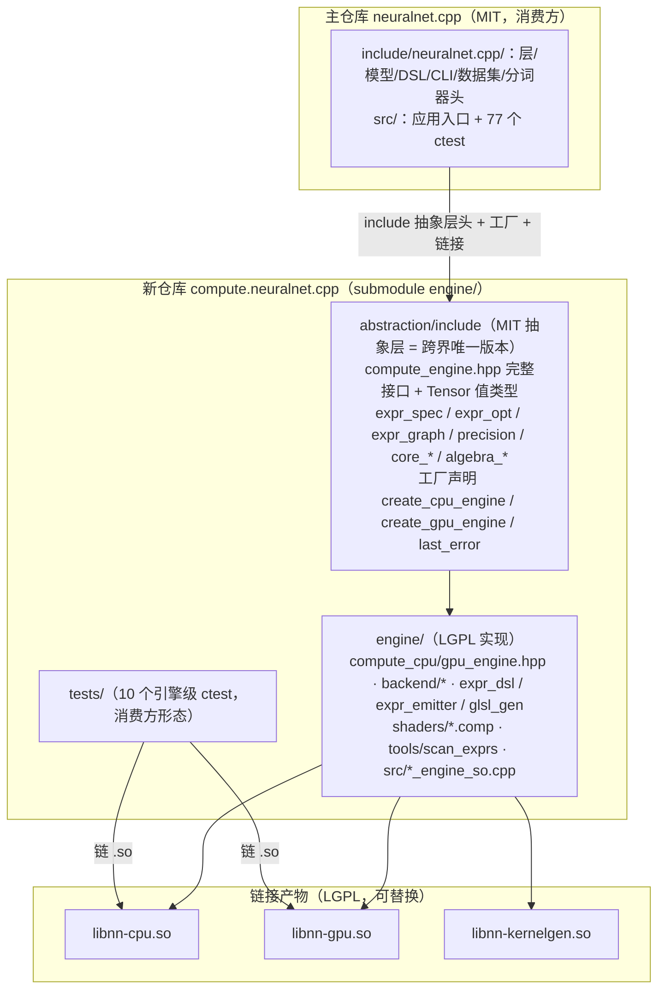

# 引擎 .so 化后的接入指南：编译流程 / 代码结构 / 调用示例

> **读者**：调用者（拿本库写自己东西的人）与项目开发者（想改引擎的人）。
> 总索引见 [`../README.md`](../README.md)；历史归档在 [`../history/history.md`](../history/history.md)。
> **一句话结论**：引擎实现已编进独立 `.so`（LGPL，新仓库 `compute.neuralnet.cpp`，
> submodule `engine/`），主仓库消费方**只 include MIT 抽象层头 + 工厂 + 链接 `.so`**；
> 本文给改链后的编译流程、代码结构、调用示例。边界清单与实施记录见
> [`../internal/34-engine-link-abi-boundary.md`](../internal/34-engine-link-abi-boundary.md) §10。
> **状态**：现行

## 1. 编译流程

引擎在**两个仓库**里构建：引擎本体（新仓库 `compute.neuralnet.cpp`，LGPL）与消费方
（主仓库 `neuralnet.cpp`，MIT）。日常开发在消费方侧。

### 1.1 主仓库（消费方，日常）

```bash snippet
cmake -B build -G Ninja -DNN_ENABLE_GPU=ON -DNN_ENABLE_TESTS=ON
ninja -C build
NN_VULKAN_DEVICE=850M ctest --test-dir build -j1
```

- `add_subdirectory(engine)` 挂入 submodule（新仓库根），构建期先产出
  `libnn-cpu.so` / `libnn-gpu.so` / `libnn-kernelgen.so`（`scan_exprs` AOT 融合 →
  `fused_registry.hpp`，158 条表达式）；主仓库全部可执行目标统一链接 `.so`。
- 默认 Release：`-O3 -fno-math-errno -fno-trapping-math -funroll-loops -march=native`
  （Clang 另开 thin LTO）。
- `NN_ENABLE_GPU`（`AUTO`/`ON`/`OFF`）一行控制 GPU：`OFF` 时不定义 `create_gpu_engine`
  符号，`cli_engine_factory` 用 `NN_GPU_ENGINE` 宏分流链接面。
- 内存受限机器上 ctest 用 `-j1`（并行会 OOM）。

### 1.2 新仓库（引擎本体，改原语/shader 时）

```bash snippet
cmake -B build -G Ninja -DNN_BUILD_TESTS=ON -DNN_ENABLE_GPU=ON
cmake --build build
NN_VULKAN_DEVICE=850M ctest --test-dir build -j1
```

⚠ 两条编译口径（逐位锚的前提）：

1. **默认 Release 必须带 `-march=native`**（CMakeLists 已内置，`NN_ENABLE_NATIVE=OFF`
   可关）：CPU 参考需要 FMA 收缩，否则与 GPU kernel（glslc 默认 FMA）累加路径不同，
   `scan_bitwise_test` 位型漂移（裸 `-O3` 实测 57/61 失败，加 `-march=native` 后 61/61）。
2. GPU 不可用 / Windows / Debug 口径不满足的测试返回 `77`，ctest 已配
   `SKIP_RETURN_CODE 77` 记为 skip 而非失败。

## 2. 代码结构



要点：

- **许可边界**：主仓库整仓 MIT；新仓库 `abstraction/` MIT、`engine/` LGPL。`.so` 内是
  真实引擎实现（header-only 编译进库），消费方动态链接、不内联 LGPL 代码，可替换
  `.so` → LGPL"可替换库二进制"承诺兑现。
- **跨界 ABI（C++ 直出）**：抽象层头是**唯一版本**（`.so` 与消费方同份编译，无双份
  漂移）；`Tensor` 是真实值类型跨界（GpuBuffer PIMPL，布局与 `NN_HAS_VULKAN` 无关），
  虚方法分派直接落 `.so`——无句柄映射、无序列化、无 dlopen。跨界前提四条：
  ① 同编译器 / 同标准库 / 同 `-fno-exceptions`；② Tensor 布局与 `NN_HAS_VULKAN` 无关
  （消费方无需同宏编译、无需 Vulkan SDK）；③ GPU 值类型析构经 `.so` 符号；
  ④ `std::shared_ptr` / `std::expected` / `std::string` 跨界由同标准库保证。
- **主仓库删掉的头**：与抽象层重复的接口/值类型头、引擎实现头（`compute_cpu_engine.hpp`、
  `backend/*`、`expr_emitter.hpp`/`expr_glsl_gen.hpp` 等）、`nn_api` C ABI 门面、
  `scan_exprs` 工具与旧 GPU 段全部删除；`expr_dsl.hpp` 保留（消费方 TU 用它写
  `dsl::compute`，模板在消费方实例化、数值与 `.so` 一致）。
- **测试分两处**：主仓库 77 个 ctest（层/模型/CLI 侧，引擎经工厂创建）；引擎级 10 个
  测试在新仓库 `tests/`（`gpu_test` / `gpu_f16_test` / `scan_bitwise_test` /
  `gpt_offload_test` / `rapt_offload_test` / `expr_graph_test` / `expr_fuse_test` +
  `consumer_test` / `gpu_consumer_test` / `kernelgen_smoke`）。

## 3. 调用示例

### 3.1 消费方 C++（标准形态）

只 include 抽象层头 + 工厂创建，真实实现编在 `.so`：

```cpp example api
#include <neuralnet.cpp/compute_engine.hpp>   // MIT 抽象层，唯一的头

auto e = nn::create_cpu_engine();              // 或 nn::create_gpu_engine("850M")
if (!e) { std::cerr << nn::last_error() << "\n"; return 1; }

nn::Matrix a(2, 3), b(3, 2);                   // 宿主 I/O 载体（Matrix，MIT 值类型）
// …填 a/b 数据…
auto ta = e->from_matrix(a);                   // Result<Tensor>（std::expected）
auto tb = e->from_matrix(b);
e->begin_batch();                              // GPU 录制窗口（CPU no-op）
auto tc = e->matmul(*ta, *tb, false, false);
e->end_batch();
auto c  = e->to_matrix(*tc);                   // 下载回宿主

std::cout << e->describe().text() << "\n";     // 能力信息唯一出口（禁止用它选路）
```

### 3.2 主仓库层/模型（写法基本不变）

引擎原语虚调用走 `.so`，DSL 模板在消费方 TU 求值：

```cpp snippet
#include <neuralnet.cpp/nn.hpp>

auto engine = nn::create_cpu_engine();                       // 工厂（非 CpuEngine::create）
auto model  = NN_UNWRAP(nn::build_gpt_model(*engine, vocab, d_model, seq, heads, d_ff, layers));
// forward / backward / 训练循环与引擎 .so 化前逐字相同——
// matmul / reduce / eval_expr 等原语经 ComputeEngine 虚接口分派进 .so
```

### 3.3 CLI（无感知）

`mnist_train` / `text_train` / `text_infer` / `tokenizer_train` 等参数与输出不变；
内部 `cli_engine_factory` 走工厂 + `NN_GPU_ENGINE` 宏分流链接面。设备选择：
`--gpu=850M` 或环境变量 `NN_VULKAN_DEVICE`。

### 3.4 LGPL 可替换验证

```bash snippet
bash bench/lgpl_verify.sh
```

验证口径 = 符号级（消费方二进制 0 个引擎实现符号）+ 行为级（patch `libnn-cpu.so`
的原语 → 同一消费方二进制 `layer_bench --op matmul --hash` 的输出 hash 变化 →
复原 `.so` → hash 复原）。正解观测点 = `layer_bench --op matmul --hash`：显式走引擎
虚方法；**训练 loss 对比不可用**（DSL 模板路径在消费方 TU 求值，不经 `.so`）。

## 4. 相关文档

- 边界清单与实施记录：[`../internal/34-engine-link-abi-boundary.md`](../internal/34-engine-link-abi-boundary.md) §10
- 引擎级测试清单 / 覆盖 / 基线：新仓库 `README.md`「引擎级测试」节；消费方接入细节：新仓库 `docs/usage.md`
- 演进记录 / 取舍 / 踩坑：[`../history/history.md`](../history/history.md)「引擎 .so 化（T9）」条
